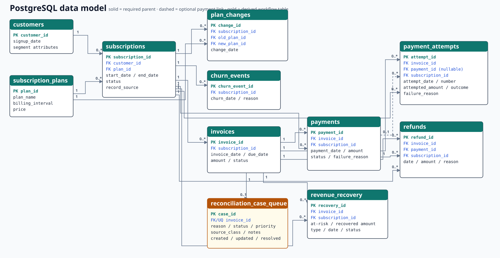
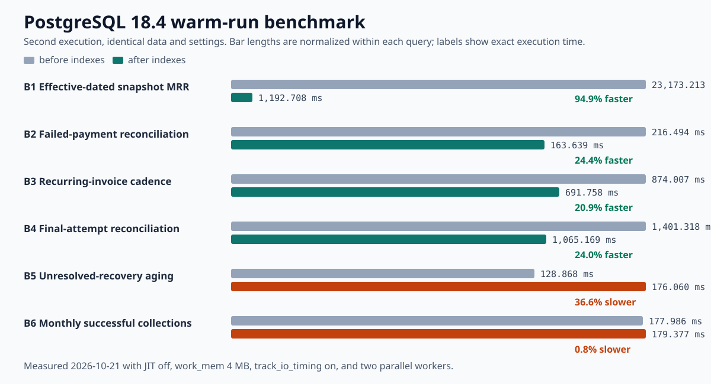

# Subscription Billing Anomaly Detection and Revenue Recovery

A PostgreSQL project for reconciling subscription billing events, identifying records that require review, measuring modeled recovery, and analyzing churn and retention. It keeps invoices, payments, attempts, refunds, and recovery events at their correct grains so inconsistencies remain visible instead of being hidden by summary reporting.

The current implementation uses PostgreSQL SQL, PL/pgSQL, `psql`, and `\copy`. It includes a constrained relational schema, reproducible import, 29 business analyses, integrity and financial tests, functions and procedures, workflow triggers, transaction demonstrations, four result exports, and measured query-plan optimization.

The repository records an earlier audit on **2026-10-21**. A live-database recheck on **2026-10-31**, using PostgreSQL 18.4, confirmed **2,207,973 rows**, the reported MRR and retention range, and 4,797 original billing conflicts. Historical benchmark timings have not been independently re-established; see the evidence status below.

## Table of contents

- [Business problem](#business-problem)
- [Objectives and technology](#objectives-and-technology)
- [Dataset and provenance](#dataset-and-provenance)
- [Database architecture](#database-architecture)
- [Repository structure](#repository-structure)
- [SQL implementation](#sql-implementation)
- [Verified business results](#verified-business-results)
- [Performance optimization](#performance-optimization)
- [Validation evidence](#validation-evidence)
- [Reproducing the project](#reproducing-the-project)
- [Limitations](#limitations)
- [Conclusion](#conclusion)

## Business problem

Subscription reports can look plausible while their underlying events disagree. A paid invoice may have no successful payment, a retry sequence may end differently from its linked payment, a refund may predate the collection it references, or activity may continue after churn. Joining these tables without controlling grain can also duplicate money and blur the difference between billed value, cash collection, and modeled recovery.

This project builds an auditable PostgreSQL model around those problems. It preserves supplied anomalies, classifies them for review, and separates directly observed records from synthetic and inferred artifacts. A flagged record is a review candidate; it is not proof of fraud, realized loss, or verified recovery.

## Objectives and technology

- Load ten related CSVs without rewriting or silently repairing source rows.
- Enforce supported entity, relationship, category, date, and financial rules.
- Reconcile invoices, payments, attempts, refunds, and recovery without multiplying amounts across one-to-many joins.
- Measure billed value, collections, a net collection proxy, contracted MRR, and ARR run-rate with explicit definitions.
- Analyze failed payments, modeled retries, refunds, churn, retention, and plan changes.
- Demonstrate PL/pgSQL functions, procedures, triggers, exceptions, transactions, and idempotent workflow behavior.
- Benchmark representative queries before and after indexing on the same data.

| Area | Implementation |
|---|---|
| Database | PostgreSQL 18.4 |
| Languages | PostgreSQL SQL and PL/pgSQL |
| Loading | `psql` and client-side `\copy` |
| Core types | `BIGINT`, `DATE`, `NUMERIC(12,2)`, `TEXT`, `TIMESTAMPTZ` |
| Analysis | Joins, CTEs, filtered aggregates, window functions, `LATERAL` |
| Database programming | Functions, procedures, triggers, identity keys, exception blocks |
| Optimization | `EXPLAIN (ANALYZE, BUFFERS)`, repeat runs, partial and covering indexes |
| Outputs | SQL-generated CSVs and SVG documentation assets |

The PostgreSQL core runs independently. The optional Python novelty-detection extension requires the pinned packages in `python/requirements.txt`; no dashboard or web service is required.

## Dataset and provenance

The hybrid dataset combines preserved Kaggle-derived rows with generated scenario data. The exact Kaggle listing and redistribution license were not supplied; confirm both before publishing the CSVs publicly. The synthetic reporting snapshot is **2026-09-30**, although some preserved and follow-up events extend beyond it.

| Table | Original | Synthetic | Original-derived | Total |
|---|---:|---:|---:|---:|
| `customers` | 25,000 | 75,000 | 0 | 100,000 |
| `subscriptions` | 25,000 | 75,000 | 0 | 100,000 |
| `subscription_plans` | 7 | 0 | 0 | 7 |
| `invoices` | 68,411 | 557,912 | 0 | 626,323 |
| `payments` | 68,411 | 557,912 | 0 | 626,323 |
| `payment_attempts` | 0 | 588,751 | 68,411 | 657,162 |
| `refunds` | 0 | 8,121 | 0 | 8,121 |
| `revenue_recovery` | 0 | 45,040 | 4,797 | 49,837 |
| `plan_changes` | 787 | 1,379 | 0 | 2,166 |
| `churn_events` | 9,757 | 28,277 | 0 | 38,034 |
| **Total** | **197,373** | **1,937,392** | **73,208** | **2,207,973** |

`original` identifies preserved source rows. `synthetic` identifies generated scenarios. `original_derived` identifies inferred artifacts based on original rows; these are not observed retries. Refund and recovery histories are synthetic, so their recovered amounts do not establish real cash recovery.

## Database architecture



The ten imported tables use primary keys and 17 foreign-key relationships. The advanced script creates `reconciliation_case_queue` as a derived operational table; imported facts remain unchanged.

| Domain | Relationships |
|---|---|
| Subscription | `customers` and `subscription_plans` → `subscriptions` |
| Plan history | `subscriptions` → `plan_changes`; both plan IDs → `subscription_plans` |
| Lifecycle | `subscriptions` → `churn_events` |
| Billing | `subscriptions` → `invoices` → `payments` |
| Attempts | `invoices`, optional `payments`, and `subscriptions` → `payment_attempts` |
| Adjustments | `invoices`, `payments`, and `subscriptions` → `refunds` |
| Recovery | `invoices` and `subscriptions` → `revenue_recovery` |
| Workflow | `invoices` → `reconciliation_case_queue` through a unique invoice key |

Currency uses `NUMERIC(12,2)`. Check constraints enforce known categories, non-negative amounts, date ordering, recovery limits, and valid status/reason combinations.

## Repository structure

```text
.
|-- assets/                         # ER and benchmark visuals
|-- data/                           # ten immutable source CSVs
|-- database/
|   |-- 01_schema.sql               # tables, keys, checks, foreign keys
|   |-- 02_import.sql               # dependency-ordered import
|   `-- 03_indexes.sql              # four measured indexes
|-- sql/
|   |-- 01_data_exploration.sql
|   |-- 02_revenue_analysis.sql
|   |-- 03_billing_anomalies.sql
|   |-- 04_payment_recovery.sql
|   |-- 05_churn_retention.sql
|   |-- 06_advanced_sql.sql
|   `-- 07_query_optimization.sql
|-- tests/
|   |-- data_integrity.sql
|   `-- financial_reconciliation.sql
|-- results/                         # four executed CSV exports
|-- DATA_DICTIONARY.md
|-- PROJECT_SPEC.md
|-- README.md
`-- .gitignore
```

## SQL implementation

### Schema, import, and validation

[database/01_schema.sql](database/01_schema.sql) creates the source tables in a transaction. It contains no `DROP` statement and refuses to run unless the connected database matches the configured project database.

[database/02_import.sql](database/02_import.sql) loads parents before children, maps unquoted empty CSV fields to SQL `NULL`, and refuses to load populated tables. One source-specific issue is handled without editing the CSV: populated `payment_attempts.payment_id` values use text such as `1.0`. The script stages them as text, rejects non-integral input, and converts validated values losslessly to `BIGINT`.

The order is `customers`, `subscription_plans`, `subscriptions`, `plan_changes`, `churn_events`, `invoices`, `payments`, `payment_attempts`, `refunds`, then `revenue_recovery`.

[tests/data_integrity.sql](tests/data_integrity.sql) checks counts, keys, null policy, foreign-key orphans, provenance, parent consistency, and dates. [tests/financial_reconciliation.sql](tests/financial_reconciliation.sql) checks invoice/payment cardinality, amounts, final attempts, duplicate attempt numbers, refund linkage, and recovery rules.

### Analysis design

The first five analysis files answer 29 business questions:

- [Data exploration](sql/01_data_exploration.sql): composition, segments, observed lifetimes, event ranges, invoice/payment alignment.
- [Revenue analysis](sql/02_revenue_analysis.sql): billing, collections, plan attribution, MRR/ARR, acquisition cohorts, moving averages.
- [Billing anomalies](sql/03_billing_anomalies.sql): status conflicts, duplicate candidates, cadence, price variance, post-churn events.
- [Payment recovery](sql/04_payment_recovery.sql): failure rates, reasons, attempts, modeled funnels, aging, refunds.
- [Churn and retention](sql/05_churn_retention.sql): logo churn, mature cohorts, churn reasons, plan changes, censored lifetimes.

CTEs establish the correct grain before aggregation. Window functions support growth, moving averages, effective plan segments, attempt sequences, cadence, cohorts, and work batches. Filtered aggregates make each numerator and denominator explicit.

Contracted MRR normalizes annual price by 12 and includes subscriptions active at the reporting date:

```sql
SELECT round(sum(fn_subscription_mrr(
           subscription_id, DATE '2026-09-30'
       )), 2) AS contracted_mrr
FROM subscriptions
WHERE start_date <= DATE '2026-09-30'
  AND (end_date IS NULL OR end_date > DATE '2026-09-30');
```

Billing conflicts remain candidates for investigation:

```sql
SELECT i.record_source,
       count(*) AS candidate_invoices,
       sum(i.amount) AS amount_for_review
FROM invoices i
JOIN payments p USING (invoice_id)
WHERE i.status = 'paid' AND p.status = 'failed'
GROUP BY i.record_source;
```

### Advanced PostgreSQL

[sql/06_advanced_sql.sql](sql/06_advanced_sql.sql) installs three functions—effective plan, subscription MRR, and invoice reconciliation—plus two procedures for idempotent queueing and locked workflow transitions. One queue-state trigger and four financial-parent triggers protect future writes.

Its demonstrations verify caught exceptions, parent mismatch rejection, duplicate protection, legal and illegal transitions, committed visibility, and serializable rollback. Test rows are rolled back or removed. The clean audit ended with no demonstration rows and all **2,207,973** source rows intact.

## Verified business results

Financial totals use events dated through **2026-09-30**.

### Revenue and contract value

| Metric | Verified value | Meaning |
|---|---:|---|
| Billed value | 33,555,578.00 | Invoice value; not recognized revenue |
| Successful collections | 30,087,516.00 | Successful payments |
| Completed refunds | 251,650.00 | Synthetic refund value |
| Net collection proxy | 29,835,866.00 | Collections less refunds |
| Contracted MRR | 1,549,314.17 | Monthly-equivalent plan value active at snapshot |
| ARR run-rate | 18,591,770.00 | MRR × 12 |
| Collection-to-bill ratio | 89.66% | Collection timing divided by billing timing |

MRR and ARR are contract run rates, not GAAP revenue, cash balances, or forecasts. The 45-row series is in [monthly_revenue_summary.csv](results/monthly_revenue_summary.csv).

### Billing anomalies and failed payments

| Finding | Rows | Amount | Interpretation |
|---|---:|---:|---|
| Paid invoices without successful payment | 35,636 | 1,884,768.00 | Combined review population |
| Original failed payment aligned to paid invoice | 4,797 | 240,760.00 | Requires review; linkage was inferred |
| Synthetic paid invoice with modeled recovery | 30,839 | 1,644,008.00 | Scenario outcome, not verified cash |
| Synthetic failed payment on open invoice | 17,749 | 961,645.00 | Open-billing context |
| Synthetic failed payment on uncollectible invoice | 9,693 | 530,143.00 | Uncollectible context |

No invoice lacks a payment; no invoice has multiple payments; and no payment differs from its invoice in amount or subscription. The analyses also found no duplicate billing groups, recurring-invoice gaps, invoices after churn, or effective-plan price differences.

There are **1,106 payments totaling 52,880.00** and **1,178 attempts totaling 56,089.00** after subscription end. These require context because later collection activity may be legitimate. The invoice-level export is [billing_review_candidates.csv](results/billing_review_candidates.csv).

### Retry, recovery, and refunds

| Provenance/status | Cases | At-risk amount | Modeled recovered |
|---|---:|---:|---:|
| Original-derived / requires review | 4,797 | 240,760.00 | 0.00 |
| Synthetic / recovered | 30,839 | 1,644,008.00 | 1,644,008.00 |
| Synthetic / unrecovered | 14,201 | 761,892.00 | 0.00 |

Synthetic sequences contain 58,281 invoices with failed attempts and 30,839 modeled recoveries: a **52.91% modeled retry recovery rate**. Original-derived attempts are inferred and excluded from observed retry claims.

Payment failure through the snapshot is **7.01%** for original rows and **10.48%** for synthetic rows. The 8,121 synthetic refunds total **251,650.00**. A known inconsistency affects 22 refunds totaling **562.75**, dated one to four days before their linked successful payments; the rows are preserved. See [payment_recovery_funnel.csv](results/payment_recovery_funnel.csv).

### Churn and retention

Mature 12-month quarterly retention ranges from **66.22% to 74.20%**. Only cohorts mature enough to reach an age enter that age's denominator.

| Churn reason | Subscriptions | Share |
|---|---:|---:|
| Price | 6,708 | 17.64% |
| Product fit | 6,494 | 17.07% |
| Budget | 6,457 | 16.98% |
| Competitor | 5,253 | 13.81% |
| Other | 4,877 | 12.82% |

All **2,166** plan changes are upgrades of exactly **19.00** normalized MRR, totaling **41,154.00**. This uniformity is a generator limitation. Active lifetimes are right-censored, so the project reports observed duration rather than predicted lifetime value. See [cohort_retention.csv](results/cohort_retention.csv).

## Performance optimization

**Evidence status (2026-10-31):** The table and graphic below preserve previously recorded results. Their original raw execution plans are not present in this repository. The SQL comments contain additional historical runs with different timings. A fresh indexed-only check returned 1,997.311 ms and 2,122.875 ms for B1; it does not establish a new before/after speedup. Do not describe the historical 94.9% reduction as independently reproduced by this recheck. A clean baseline is pending authentication setup for a separate database.

[sql/07_query_optimization.sql](sql/07_query_optimization.sql) runs each benchmark twice before and after indexing. The table uses the warm second execution from the clean audit with `jit=off`, `track_io_timing=on`, `work_mem='4MB'`, and two parallel workers.



| Benchmark | Before | After | Change | Plan effect |
|---|---:|---:|---:|---|
| Effective-dated snapshot MRR | 23,173.213 ms | 1,192.708 ms | 94.9% faster | Effective-date index replaces repeated history scans |
| Failed-payment reconciliation | 216.494 ms | 163.639 ms | 24.4% faster | Partial index-only scan reads failures |
| Recurring-invoice cadence | 874.007 ms | 691.758 ms | 20.9% faster | Covering index removes a 23,936 kB external sort |
| Final-attempt reconciliation | 1,401.318 ms | 1,065.169 ms | 24.0% faster | Ordered index removes a 31,984 kB attempt sort |
| Unresolved recovery aging | 128.868 ms | 176.060 ms | 36.6% slower | Sequential scans retained; no index added |
| Monthly collections | 177.986 ms | 179.377 ms | 0.8% slower | Broad sequential scan remains appropriate |

[database/03_indexes.sql](database/03_indexes.sql) retains four measured indexes:

| Index | Purpose | Size |
|---|---|---:|
| `idx_plan_changes_subscription_effective` | Effective plan lookup | 144 kB |
| `idx_invoices_subscription_date` | Billing history and cadence | 35 MB |
| `idx_payment_attempts_invoice_sequence` | Final attempt per invoice | 42 MB |
| `idx_payments_failed_invoice` | Failed-payment reconciliation | 4,176 kB |

They occupy about 81 MB. Recovery aging and monthly collections show why every filter does not receive an index: broad predicates retained sequential plans and showed no benefit. Timings depend on hardware, cache, and worker scheduling; the plan changes are more portable than one runtime.

## Validation evidence

| Validation group | Clean-audit result |
|---|---|
| 10 table totals | All passed |
| 10 primary-key uniqueness checks | All passed |
| 15 required/expected-null checks | All passed |
| 17 foreign-key orphan checks | All passed |
| 18 provenance totals | All passed |
| Invoice/payment cardinality and amounts | Passed; documented status conflicts retained |
| Attempt parents, numbering, final outcome | All passed |
| Refund parents and amount limits | Passed |
| Recovery parents, amounts, dates, failure linkage | All passed |
| Source date rules | One documented failure: 22 pre-payment refunds |
| Transaction demonstrations | All passed; no demo rows remained |

Post-churn payments, attempts, and recoveries are informational review cases because validity depends on collection policy.

## Reproducing the project

Install PostgreSQL and expose `createdb` and `psql` on the command line. Configure authentication through PostgreSQL, such as `pgpass.conf`; never commit credentials. Run from the repository root so `data/` and `results/` resolve.

### 1. Create an empty database

```powershell
createdb -w -h localhost -p 5432 -U postgres saas_revenue_assurance
```

### 2. Build, import, and validate

```powershell
psql -X -w -h localhost -p 5432 -U postgres -d saas_revenue_assurance -f database/01_schema.sql
psql -X -w -h localhost -p 5432 -U postgres -d saas_revenue_assurance -f database/02_import.sql
psql -X -w -h localhost -p 5432 -U postgres -d saas_revenue_assurance -f tests/data_integrity.sql
psql -X -w -h localhost -p 5432 -U postgres -d saas_revenue_assurance -f tests/financial_reconciliation.sql
```

`\copy` reads client-side files, uses headers, maps empty fields to SQL `NULL`, and leaves source files unchanged.

### 3. Run analyses and generate exports

```powershell
psql -X -w -h localhost -p 5432 -U postgres -d saas_revenue_assurance -f sql/01_data_exploration.sql
psql -X -w -h localhost -p 5432 -U postgres -d saas_revenue_assurance -f sql/02_revenue_analysis.sql
psql -X -w -h localhost -p 5432 -U postgres -d saas_revenue_assurance -f sql/03_billing_anomalies.sql
psql -X -w -h localhost -p 5432 -U postgres -d saas_revenue_assurance -f sql/04_payment_recovery.sql
psql -X -w -h localhost -p 5432 -U postgres -d saas_revenue_assurance -f sql/05_churn_retention.sql
psql -X -w -h localhost -p 5432 -U postgres -d saas_revenue_assurance -f sql/06_advanced_sql.sql
```

### 4. Benchmark before and after indexes

```powershell
psql -X -w -h localhost -p 5432 -U postgres -d saas_revenue_assurance -f sql/07_query_optimization.sql
psql -X -w -h localhost -p 5432 -U postgres -d saas_revenue_assurance -f database/03_indexes.sql
psql -X -w -h localhost -p 5432 -U postgres -d saas_revenue_assurance -f sql/07_query_optimization.sql
```

For another deliberate database name, pass it consistently:

```powershell
psql -X -w -h localhost -U postgres -d my_audit_database -v project_database=my_audit_database -f database/01_schema.sql
```

Apply the same variable to `02_import.sql`, `06_advanced_sql.sql`, `07_query_optimization.sql`, and `03_indexes.sql`. There is no destructive reset; use a new empty database for a rebuild.

## Limitations

- The exact Kaggle URL, citation, and redistribution license need confirmation before public CSV distribution.
- Original payment-to-invoice links were inferred; the 4,797 original mismatches do not prove fraud or loss.
- Original-derived attempts are proxies, not observed retries.
- Refund and recovery records are synthetic; recovered amounts are not verified cash.
- Twenty-two synthetic refunds predate linked payments and remain unchanged.
- Most synthetic recurring invoices use full cycles without churn proration.
- Some events occur after churn or the scenario snapshot and need business context.
- Uniform upgrade-only plan history limits conclusions about expansion and contraction.
- Active lifetimes are right-censored; no predictive lifetime value is claimed.
- Benchmarks describe this installation and dataset, not universal production performance.

## Conclusion

This project turns a 2.2-million-row hybrid subscription dataset into a reproducible PostgreSQL revenue-assurance workflow. It enforces relational integrity, preserves known inconsistencies, reconciles money at the invoice grain, distinguishes observed records from modeled recovery, and documents review candidates without overstating their meaning.

The verified analysis establishes a **29,835,866.00** net collection proxy, **1,549,314.17** contracted MRR, a **52.91%** synthetic retry recovery rate, and mature 12-month retention between **66.22% and 74.20%**. The advanced SQL layer adds auditable case management, while the benchmark harness evaluates indexing with repeated execution plans. The historical **94.9%** reduction remains subject to the evidence qualification above.

## Interview walkthrough

### What this project actually implements

> I built a PostgreSQL subscription billing reconciliation project using 2.21 million records across ten source tables. It flags rule-based invoice and payment inconsistencies, measures contracted MRR and maturity-adjusted retention, and analyzes simulated recovery outcomes. I used PL/pgSQL functions, procedures, triggers, and a reconciliation queue to demonstrate a review workflow. I also built a repeated EXPLAIN ANALYZE benchmark for indexing.

The core implements descriptive financial analysis and rule-based detection. A separate Python extension now uses pandas, NumPy and scikit-learn Isolation Forest to score invoice novelty. It does not implement acquisition-funnel friction analysis, fake engagement detection, or future payment-failure prediction. Its payment retry funnel is a modeled billing sequence, not a behavioral acquisition funnel. The Python extension was added after the core; do not imply it was part of the original SQL implementation or original development dates.

### Resume claim to implementation

| Claim | Open this implementation | Evidence and qualification |
|---|---|---|
| 2.21 million rows across ten tables | `database/01_schema.sql`, `database/02_import.sql`, `tests/data_integrity.sql` | Live counts total 2,207,973; keys, null policy, relationships and provenance checks pass. |
| Financial reconciliation without multiplying amounts | `sql/02_revenue_analysis.sql` Q1/Q3; `sql/06_advanced_sql.sql`, `fn_invoice_reconciliation` | Aggregate each financial layer before joining; do not add attempts or modeled recoveries to collected cash. Current invoices have one payment each. |
| Contracted MRR | `sql/02_revenue_analysis.sql` Q5 | 1,549,314.17 at 2026-09-30; annual prices divided by 12 and effective plan history applied. |
| Mature cohort retention | `sql/05_churn_retention.sql` Q2 | 12-month range reproduced: 66.22%-74.20%; only subscriptions old enough to reach each measurement age enter its denominator. |
| 4,797 invoice/payment conflicts | `sql/03_billing_anomalies.sql` Q1/Q2; `tests/financial_reconciliation.sql` | Original failed payments aligned to paid invoices; inferred linkage means investigation candidates, not confirmed loss. |
| Functions, procedures and triggers | `sql/06_advanced_sql.sql` | Live demonstrations passed on 2026-10-31, including exceptions, parent validation, duplicate queueing, legal/illegal transitions and rollback. |
| Indexing and EXPLAIN ANALYZE | `database/03_indexes.sql`, `sql/07_query_optimization.sql` | Four indexes installed; historical 23.17s to 1.19s timings lack retained raw plans. Current indexed-only timings cannot verify the historical percentage. |

### Five-minute demonstration

1. Open the schema and explain invoices, payments, attempts, refunds and recovery as different event grains.
2. Run `tests/data_integrity.sql`. Explain that the 22 pre-payment refunds are intentionally preserved failures, not silently corrected data.
3. Open billing Q1 and show why the 4,797 original conflicts require review. Contrast inferred linkage with a native payment-provider invoice reference.
4. Open revenue Q5 and retention Q2. Explain monthly normalization, effective dates, the reporting snapshot, and cohort maturity.
5. Run `sql/06_advanced_sql.sql` in a project demonstration database. It installs objects and exercises queue writes; demo rows are removed or rolled back. It is not a read-only script.
6. Open the benchmark harness and explain the effective-plan lookup index, repeated runs, cache effects, and why broad scans may not benefit from an index. State the historical evidence limitation explicitly.

Use the commands in Reproducing the project. The analysis scripts with `\copy` regenerate their named result CSVs. Preserve an export before rerunning if you need to compare it. Never rerun the import into populated tables.

### Questions to prepare for

**How does anomaly detection work without ML?** Explicit SQL rules compare related records and expected billing behavior. For example, a paid invoice with no successful payment is a review candidate. Rules are interpretable but cannot establish intent or detect every unknown pattern.

**How did you prevent double-counting?** Payments and attempts represent different layers. Financial totals come from payment rows; refunds and recoveries are aggregated separately. Joining raw attempts to payments before summing would repeat payment values for invoices with retries.

**Did you recover real revenue?** No. Recovery amounts describe synthetic scenarios. The operational queue demonstrates how a reviewer could investigate a discrepancy; it does not contact a payment gateway or collect money.

**Why adjust retention for maturity?** A subscription that began six months ago cannot have an observed twelve-month outcome. Including it in the twelve-month denominator would bias the rate downward.

**What exactly improved with indexing?** The benchmark's MRR function repeatedly looks up effective plan history. The index on subscription and descending effective date supports that lookup. Historical timings were recorded as 23.17s and 1.19s; original raw plans are unavailable, so the exact historical improvement remains unverified. Do not present a fresh indexed-only run as a before/after comparison.

**What does the Python model add?** It ranks invoice patterns that differ from earlier invoices using an unsupervised Isolation Forest. It uses invoice-time features and evaluates on later periods. It complements explicit reconciliation rules; no independent labels exist to establish detection accuracy. Synthetic review flags are not proof of fraud.

**What would production need?** Native provider identifiers, clear event-time and end-date policies, partial-payment and refund handling, incremental ingestion, concurrency tests, monitored reconciliation jobs, and reviewed resolution reasons.

### Known implementation limits to disclose

- Snapshot MRR excludes subscriptions on their end date; the reusable MRR function includes that date. Use the snapshot query's explicit eligibility filter when reproducing the quoted figure. This inconsistency is documented and remains unfixed because the existing SQL files are preserved.
- Retention counts an end date equal to the measurement date as retained. Explain this inclusive retention convention rather than assuming it matches the MRR convention.
- The reconciliation function checks successful amounts rather than successful-row existence. A hypothetical successful zero-value payment could be classified as missing success. The supplied data contains no such flagged paid/successful zero-value cases, but this is a limitation for extending the workflow to free invoices.
- The monthly churn numerator is not explicitly restricted to the opening population. Subscriptions starting and ending in the same month could distort that rate in another dataset.
- An anomaly query reporting zero candidates means its rule found no matches in this dataset; it does not prove all billing is correct.
- The visible Git commit is dated 2026-10-21. Repository evidence does not establish February-March development dates; use actual personal work history when discussing chronology.

### Latest verification and remaining setup

On 2026-10-31 the existing PostgreSQL database was checked with both validation scripts, the first five analytical scripts (without rewriting exports), the advanced SQL demonstrations and the indexed benchmark harness. The revenue and retention queries reproduced the published key figures. Advanced demonstrations ended with no demonstration rows and all 2,207,973 source rows intact. Existing SQL files were not changed.

A separate empty database named `saas_interview_20261031` was created for a clean rebuild. Authentication for that database was unavailable, so no schema or CSVs were loaded into it and no fresh unindexed baseline was obtained. Configure local PostgreSQL authentication for the chosen verification database without committing credentials. Then use the documented setup order, passing `-v project_database=saas_interview_20261031` consistently. Capture the benchmark output with psql's `-o` option before indexes and again after indexes; retain both runs and compare the same queries and settings. Do not drop existing indexes merely to recreate a historical number.

## Optional Python invoice novelty extension

The existing SQL files and source CSVs are unchanged. `python/invoice_novelty.py` reads three CSVs, creates one feature row per invoice with a validated many-to-one subscription join, and trains an Isolation Forest. This is an implemented unsupervised ML extension, not a supervised fraud classifier or forecast of future anomalies.

```powershell
python -m pip install -r python/requirements.txt
python -m unittest discover -s python -p "test_*.py"
python python/invoice_novelty.py
```

Run with Python 3.11.9 (tested environment) from the repository root. The script resolves input/output paths from its own location and writes only `results/python/`. It does not connect to or modify PostgreSQL. Re-running replaces its generated output files. No model pickle is loaded or required; the deterministic training command rebuilds the model.

| Design choice | Implementation |
|---|---|
| Features available at invoice creation | Log invoice amount, due-date interval, subscription tenure, prior invoice gap, first-invoice indicator |
| Training | Invoices before 2025-01-01 |
| Threshold calibration | 2025 invoices; strictly above the 99th percentile of novelty scores |
| Held-out test | 2026-01-01 through 2026-09-30 |
| Model | 100-tree Isolation Forest, max_samples=2048, seed=42, one worker |
| Outputs | Held-out invoice scores, source-segment summary, versions/split counts/source hashes |
| Evaluation | Review volume and retrospective overlap with paid-invoice/no-success rules; no claimed precision, recall or fraud accuracy |

No payment status, invoice status, recovery outcome, source label or SQL review flag enters the model. Outcomes are joined only after scoring for diagnostic comparison. The model uses no future invoice gap. Same-day invoice IDs provide a deterministic order; without event timestamps the within-day order cannot be independently established. Repeated subscriptions across time are allowed, so this evaluates later invoices, not generalization to unseen customers.

The model pools original and synthetic data. It can flag generator artifacts, annual billing or source distribution shifts rather than errors. The source-segment report makes this visible; it does not remove the bias. A 99th-percentile calibration threshold expresses an approximate review budget, not a measured anomaly prevalence. Ties and distribution shift mean the test flag rate need not equal 1%.

The five tests check temporal split boundaries, invariance of past features when future invoices are appended, rejection of duplicate invoice IDs and duplicate parent keys, and exclusion of outcome columns from features. CSV SHA-256 hashes recorded before and after execution verify that the three consumed inputs are unchanged.

Scikit-learn documents that lower `score_samples` values indicate more unusual observations; this extension negates that score for a higher-is-more-unusual ranking. Scores are not probabilities. See the [official IsolationForest reference](https://scikit-learn.org/stable/modules/generated/sklearn.ensemble.IsolationForest.html).

For interviews: “I retained SQL rules for explainable reconciliation and added a separate unsupervised Python experiment for invoice novelty. I trained on earlier periods, calibrated a review threshold on a later period and held out 2026. Because there are no independently verified labels, I report workload and rule overlap rather than claiming fraud-detection accuracy.”

### Executed Python results

The extension was executed on 2026-10-31 with the pinned environment. It trained on **156,942** invoices, calibrated on **246,472**, and scored **222,909** held-out invoices. It flagged **2,261 (1.014%)** for review. Among those flags, **124** also matched the retrospective SQL review proxy; there were **12,189** proxy-positive invoices in the holdout overall. This overlap is not detection accuracy or evidence of incremental business value. The model and reconciliation rules ask different questions.

**Every held-out invoice is synthetic.** The temporal test provides no evidence of generalization to original-source invoice anomalies. Future evaluation needs independently reviewed examples and an original-source holdout with sufficient later history. The existing results should be presented as a reproducible experiment, not a validated production detector.

Generated artifacts: [invoice scores](results/python/invoice_novelty_scores.csv), [source summary](results/python/novelty_summary.csv), and [run metadata with input hashes](results/python/run_metadata.json). Scores and feature values support investigation; no model attribution or causal explanation is claimed.
